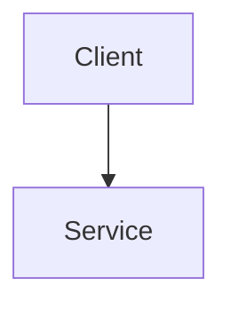

# <Feature> — Design
**Status:** DRAFT
**Spec:** docs/specs/<folder>  ·  **Phase:** N of M
**Date:** YYYY-MM-DD
**Source brief:** <where the idea came from>
**Depends on:** <prior phase, or "none">

## Overview / Approach
<!-- The chosen approach in prose. Why this over the alternatives you considered. -->

## Architecture
<!-- Components, boundaries, and how data flows. Add a Mermaid diagram when it clarifies. -->

## Components and Interfaces
<!-- Modules, function/type signatures, contracts. -->

## Data Models
<!-- Tables / types / columns / constraints. Use tables. Note enums and migrations. -->

| Column | Type | Constraints | Purpose |
|---|---|---|---|
|  |  |  |  |

## Error Handling
<!-- Failure modes, validation, fallbacks, retries. -->

## Testing / Verification Strategy
<!-- How each requirement gets verified (automated where possible; manual steps otherwise). -->

## Reuse Map
<!-- Existing pattern → file path to copy, so we don't reinvent. -->

| Need | Existing pattern | File |
|---|---|---|
|  |  |  |

## Risks & Mitigations

| Risk | Mitigation |
|---|---|
|  |  |

## Files Changed Summary

| File | Change | Scope note |
|---|---|---|
|  | NEW / EDIT / REGENERATE |  |
